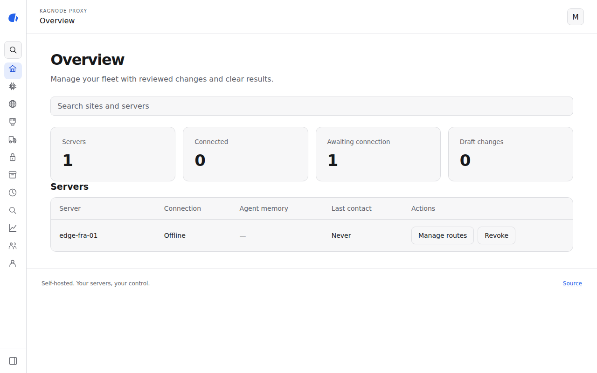
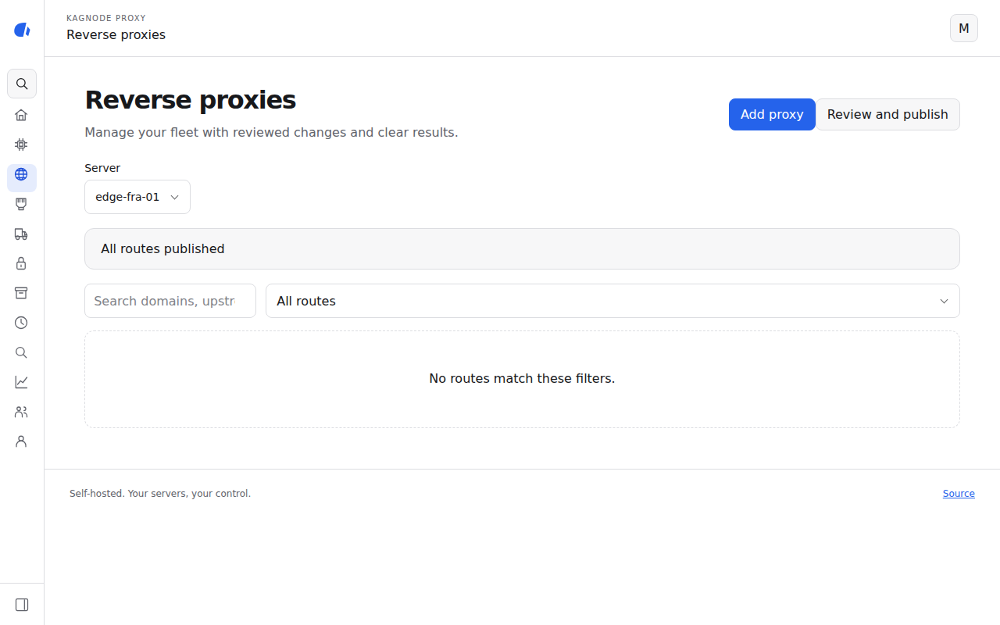
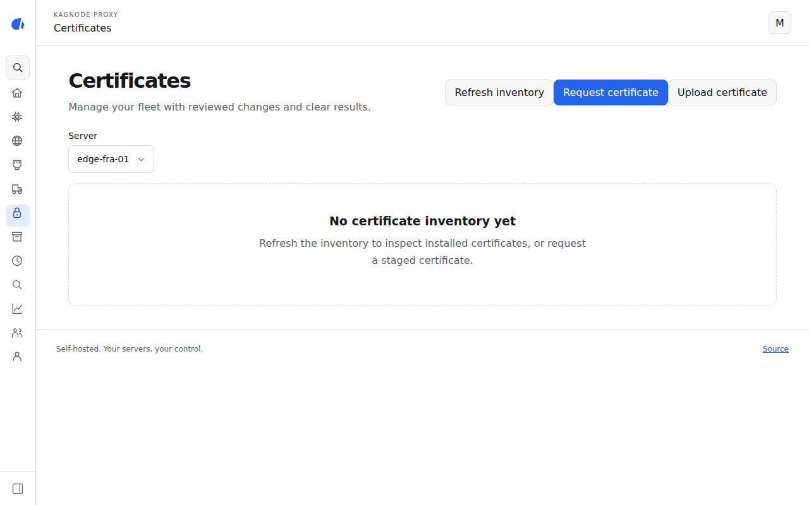
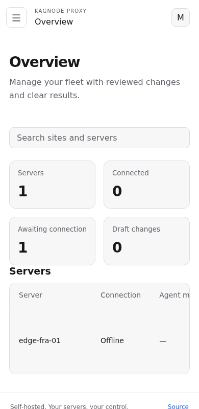

<p align="center"></p>

# KagNode. Proxy

_Formerly KagNode. PM. The repository is now [`every-lemon/kagnode-proxy`](https://github.com/every-lemon/kagnode-proxy). Package names, the `kagnode-pm` command, installed paths, API paths, update identifiers and published release assets keep their original identifiers._

A new Rust application for managing reverse proxies, authenticated forward proxies and server maintenance across a fleet.

## Overview

Screenshots come from an isolated test controller with one fictional, offline server.

| Overview                                                                                             | Reverse proxies                                                                            |
| ---------------------------------------------------------------------------------------------------- | ------------------------------------------------------------------------------------------ |
|  |  |
|                                                |                                 |

| Step                                          | Detail                                                                                                                           |
| --------------------------------------------- | -------------------------------------------------------------------------------------------------------------------------------- |
| One controller, many servers                  | You run the controller once.                                                                                                     |
| You edit typed configuration                  | Reverse hosts, upstreams (with weights), TCP/UDP streams and authenticated forward proxies are structured forms, not free text.  |
| Review, then publish                          | A publication is a reviewed snapshot.                                                                                            |
| Agents do the work; Nginx carries the traffic | The controller and agents manage configuration; Nginx (and optionally 3proxy) handles the traffic.                               |
| Bring what you already have                   | Read-only discovery finds existing Nginx, Caddy, Apache, HAProxy and Traefik setups so you can review and import them as drafts. |
| Certificates                                  | You choose the ACME authority and validation method, or upload a certificate, which is queued and encrypted.                     |
| Accounts and audit                            | Local accounts support MFA and recovery codes, with per-node permissions and an audit record of changes.                         |
| Qualification matters                         | Listing a feature here does not mean its native runtime is qualified.                                                            |

## Release status

**Source version 5.0.4: visible KagNode. Proxy branding.** Published and deployed.

|              |                                                                                   |
| ------------ | --------------------------------------------------------------------------------- |
| Source       | Merged                                                                            |
| Release      | 5.0.4 published, 13 assets, signed                                                |
| Deployed     | Yes, on the KagNode proxy host; routes and Nginx traffic unchanged                |
| Not verified | ARM native run, every ACME provider, forced-expiry renewal, automatic-update path |

Implemented functions versus verification still required: [delivery checklist](docs/DELIVERY.md).

## Features

- Typed reverse-host, upstream, TCP/UDP and forward-proxy configuration.
- Multi-server enrollment, mutual TLS identities, revocation and durable jobs.
- Local accounts, MFA/recovery codes, node permissions, revision checks and audit records.
- KagNode Core presentation, served locally with an embedded fallback.
- Dependency-aware package-removal previews and a restricted local execution helper.
- Read-only discovery for Nginx, Caddy, Apache, HAProxy and Traefik, with source review and verified draft import.

## Requirements

Target systems: Ubuntu 24.04 or Debian 13, Linux amd64/arm64 with systemd. Nginx is the qualified native reverse engine; alternative-engine configuration previews reject unsupported policies and remain gated from native activation. forward listeners…

## Installation and downloads

| Platform     | Architecture           | Application/native status                                     |
| ------------ | ---------------------- | ------------------------------------------------------------- |
| Ubuntu 24.04 | amd64 / arm64          | amd64 native verified; arm64 build/tests pass, native pending |
| Debian 13    | amd64 / arm64          | Qualification pending                                         |
| Rocky Linux  | noarch source/data RPM | No native support claim                                       |

## Usage

## Configuration and storage

New managed installations use `/srv/kagnode/proxy-manager/`. Controller and agent data are separate; runtime sockets, OS services and package-manager state remain in their system locations.

## Security

Read [SECURITY.md](SECURITY.md). The web process cannot issue arbitrary shell commands.

## Development and testing

```sh
cargo fmt --check
cargo clippy --all-targets -- -D warnings
cargo test
```

## Documentation

|                                               |                                              |
| --------------------------------------------- | -------------------------------------------- |
| Configuration discovery and engine comparison | [docs/DISCOVERY.md](docs/DISCOVERY.md)       |
| Certificate authorities and uploads           | [docs/CERTIFICATES.md](docs/CERTIFICATES.md) |
| Native deployment and legacy migration        | [docs/MIGRATION.md](docs/MIGRATION.md)       |
| Delivery and verification checklist           | [docs/DELIVERY.md](docs/DELIVERY.md)         |
| Repository map                                | [docs/STRUCTURE.md](docs/STRUCTURE.md)       |
| Security policy                               | [SECURITY.md](SECURITY.md)                   |
| Changelog                                     | [CHANGELOG.md](CHANGELOG.md)                 |

## Licensing

Application source: **AGPL-3.0-only**. Retain third-party notices and their licenses.
